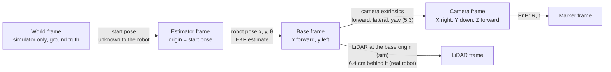
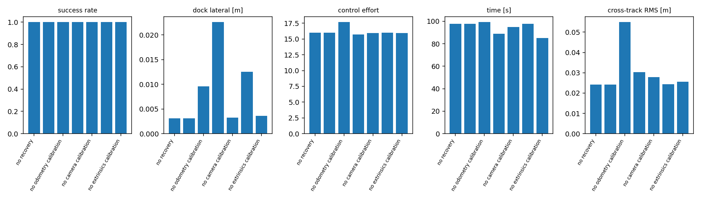
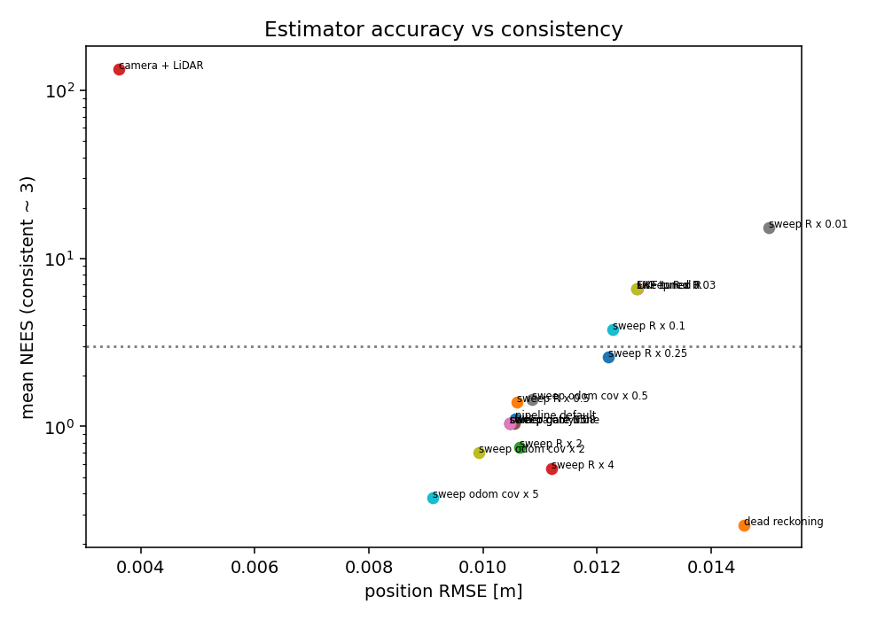
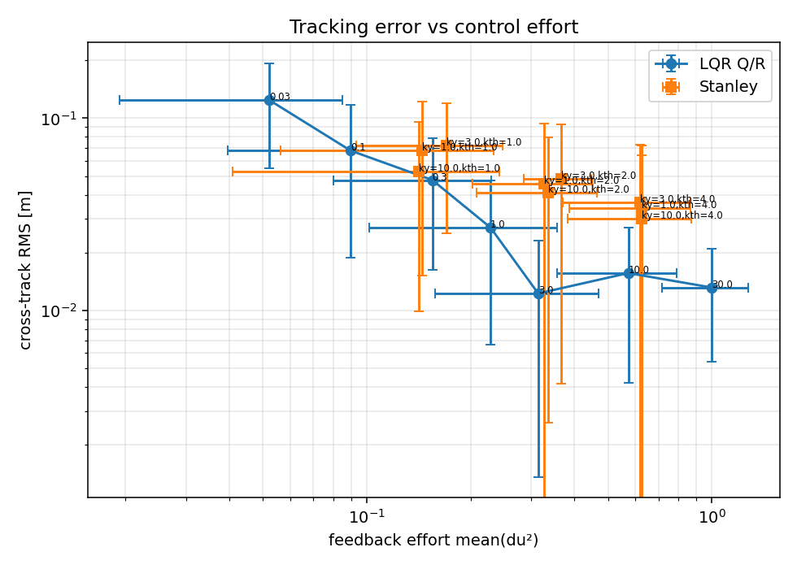
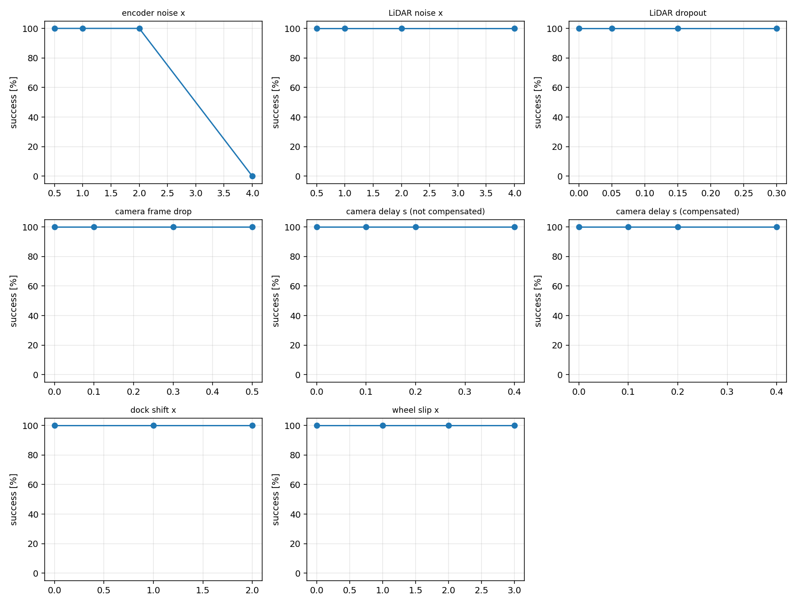
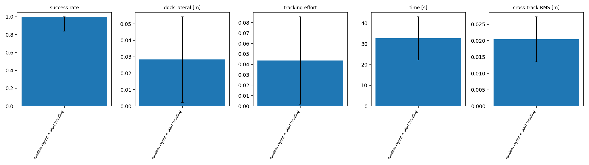

# Track A: Visual Waypoint Navigation and Docking for a TurtleBot3

41014 Sensors and Control in Mechatronics Systems, Integrated Project

| Name | Student ID |
|---|---|
| Thien Phu Le | 25661048 |
| Tran Minh Thi Nguyen | 14621635 |
| Nguyen Hoang Tung Dao | 26631301 |

---

**Group:** 6\
**Video (5 min):** <https://youtu.be/GFhhgJOjSjE>\
**Repository:** <https://github.com/TobeNguyen/Sensor-and-control-AT2>

## Quick start

```bash
python -m venv venv && source venv/bin/activate
pip install -r requirements.txt
python main.py --seed 42             # one run in simulation with the live monitor
python evaluation.py --plot-only     # rebuild all tables and figures from results/evaluation
pytest                               # test suite
```

Full evaluation and real-robot commands: section 12.

---

## 1. Overview

A TurtleBot3 Waffle starts at an unknown pose in a room containing obstacles. It has to find a charging dock marked with an ArUco marker, drive to it without collisions and dock in front of it. The robot is given no map: marker poses are learned at run time and obstacles are seen only through the LiDAR.

The system combines four components, each one assessed separately:

| Component | Implementation |
|---|---|
| Model | Unicycle kinematics, marker measurement model, linearised tracking-error model |
| Sensing | Wheel encoders, 360-beam LiDAR, monocular camera with ArUco detection |
| Estimation | Extended Kalman Filter on the planar pose |
| Control | Discrete-time LQR path tracker, LiDAR avoidance, visual-servoing docking |

The software never uses ground truth for control. The simulator exposes ground truth in a single place, which feeds the evaluation metrics only. The robot software talks to the robot through one interface (`environment.py`), used by both the simulator and the real robot. On the real robot a simplified runner (`hardware.py`, section 11) uses the same sensing, calibration and marker-measurement code, but replaces the EKF and the LQR by wheel odometry and a turn-and-drive controller.

---

## 2. Pipeline

```
SURVEY -> EXPLORE (only if the dock was not seen) -> NAVIGATE (AIM) -> DOCK -> DONE
                         ^                                  |            |
                         +--------------- RECOVER <---------+------------+
                                (any phase can end in FAILED)
```

| Phase | Behaviour |
|---|---|
| **SURVEY** | Rotates in small steps at the start pose, stopping between steps. Markers are added to the map only while the robot is stationary, because the image is then sharp and not delayed. |
| **EXPLORE** | Entered if the dock was not seen. Repeats *pick direction, turn, move, stop-and-scan*. Directions are scored by free LiDAR space, distance from places already scanned and the stand-off points of known tags. Ends when the dock pose has been learned from enough observations. |
| **NAVIGATE (AIM)** | A *look, turn, move* loop: stand still and observe the dock, turn towards it, drive a short segment with LQR tracking and LiDAR avoidance, repeat. If the dock is not seen, fall back to the dock approach point, then to each known tag in turn, with a limited (half-turn) scan at every point. |
| **DOCK** | Visual servoing on range, bearing and marker view angle. The EKF estimate bridges short marker losses, and a real detection always overrides the map estimate. |
| **RECOVER** | Started when the position uncertainty exceeds a threshold. Spins to look for a tag, drives to a tag stand-off point, and finally follows the learned map to the dock approach point. |

Hand-over rules worth noting:
- AIM hands over to DOCK when the dock is seen on its axis at close range.
- A docking attempt that takes too long, or fails, returns to AIM (up to three retries).
- DOCKED is declared only after consecutive real detections inside the tolerances, never from the estimate alone.

---

## 3. Repository layout

| File | Role |
|---|---|
| `main.py` | State-machine loop (`run_pipeline`) and command line |
| `config.py` | All parameters of the simulation |
| `robot_model.py` | Motion and measurement models, Jacobians, tracking-error model, controllability and observability, `TagMap`, run result types |
| `estimator.py` | EKF, NEES and chi-square helpers |
| `controller.py` | LQR tracker, command limits, front-obstacle speed limiter |
| `navigation.py` | Waypoint navigator with LiDAR avoidance, AIM controller |
| `docking.py` | Visual-servoing docking, dock re-learning from close views |
| `recovery.py` | Tag recovery, stop-go scan, EXPLORE |
| `sensing.py` | Sensor frames, ArUco detection, LiDAR utilities |
| `calibration.py` | Camera intrinsics and extrinsics, frame-convention checks |
| `calibrate_odometry.py` | Wheel radius and wheel base calibration |
| `safety.py` | Command filter and latched emergency stop |
| `environment.py` | Robot interface shared by simulator and real robot |
| `simulation.py` | MuJoCo scene, sensors with imperfections |
| `visualization.py` | Live monitor, final report, route record |
| `evaluation.py` | Systematic evaluation (criteria A to E) |
| `hardware.py` | Simplified runner for the real TurtleBot3 (odometry, stop-and-look state machine, visual-servoing docking, LiDAR final approach), pre-flight check and odometry calibration on the robot |
| `hardware_sim.py` | Runs the `hardware.py` state machine in MuJoCo under real-robot conditions |
| `rosbridge_api.py` | rosbridge client (UTS-RI): velocity command, camera, laser scan and joint states |
| `check_markers.py` | Checks the printed ArUco markers on the real camera: dictionary, IDs, marker size, docking conditions |
| `wheel_check.py` | Short in-place rotation to check that the robot responds before a run |

---

## 4. Modelling (criterion A)

### 4.1 Frames and conventions

- **Estimator frame:** origin at the robot start pose. Learned marker poses and all control quantities live in this frame.
- **World frame:** used only to draw results and to compare against ground truth.
- Bearing is positive to the left. The marker view angle is zero when the marker faces the robot head-on. The camera frame is X right, Y down, Z forward. A set of automatic checks (`check_frame_conventions`) verifies that points ahead, to the left and above the camera project to the expected pixels, that the camera-robot transform round-trips, and that a head-on marker gives zero bearing and view angle.



From measurement to control: the marker pose from PnP (camera frame) is transformed with the camera extrinsics into the base frame and reduced to `[range, bearing, view]` (section 4.3). The EKF uses these to correct the robot pose in the estimator frame, where the learned marker map also lives. The LQR acts on the tracking error between this estimated pose and the reference segment, expressed in the base frame (section 4.4). The world frame and ground truth are used only by the evaluation.

### 4.2 Robot kinematics

State `x = [x, y, theta]`. The wheel encoders give the input `(ds, dtheta)`:

```
ds     = r (dl + dr) / 2
dtheta = r (dr - dl) / b                (r: wheel radius, b: wheel base)

x'     = x + ds cos(theta + dtheta/2)
y'     = y + ds sin(theta + dtheta/2)
theta' = theta + dtheta
```

### 4.3 Marker measurement

For a marker at `(mx, my)` with yaw `psi`:

```
range   = sqrt((mx - x)^2 + (my - y)^2)
bearing = atan2(my - y, mx - x) - theta
view    = psi - pi - theta
```

The camera supplies the three quantities `[range, bearing, view]`. The view angle depends only on the heading, which is what makes the full pose observable from a single marker frame.

### 4.4 Tracking-error model for the LQR

The error is expressed in the robot frame, linearised at the reference speeds and discretised with an Euler step (`tracking_error_model`):

```
e_dot = A e + B u,   A = [[0, w_ref, 0], [-w_ref, 0, v_ref], [0, 0, 0]]
                     B = [[-1, 0], [0, 0], [0, -1]]
```

### 4.5 Controllability and observability

Ranks are computed numerically (`analyse_model`) at four operating points, with the marker near and far (the ranks did not depend on the distance). The observability Gramian over a 100-step (2 s) trajectory adds a measure of *how well* a direction is observed, which a rank cannot give.

| Operating point | Controllability rank | Observability rank (range + bearing) | Observability rank (+ view angle) | Smallest Gramian eigenvalue, without view | Smallest Gramian eigenvalue, with view |
|---|---|---|---|---|---|
| stopped (v = 0, w = 0) | 2 | 2 | 3 | ≈ 0 (−2.1e-10) | 8.56e4 |
| straight (v = 0.2) | 3 | 3 | 3 | ≈ 0 (−5.2e-10) | 8.59e4 |
| turn in place (w = 0.5) | 3 | 2 | 3 | ≈ 0 (−2.1e-10) | 8.56e4 |
| arc (v = 0.15, w = 0.4) | 3 | 3 | 3 | ≈ 0 (−4.1e-10) | 8.58e4 |

What the numbers show:

- **Controllability.** With `v = w = 0` the matrix `A` of the error model is zero and no input acts on the lateral error, so the rank is 2. As soon as the robot translates or rotates, `A` couples the along-track error into the lateral one and the rank is 3. The LQR is designed at a non-zero cruise speed (0.15 m/s), where the pair is fully controllable.
- **Observability from range and bearing.** The rank is 2 when the robot is stopped or turns in place, because the position does not change and one viewpoint gives two independent measurements for three states. It is 3 once the robot translates.
- **Observability with the view angle.** The rank is 3 at every operating point, including standing still. A single marker frame is enough to observe the full pose.
- **Rank versus Gramian.** Without the view angle the smallest Gramian eigenvalue is zero to numerical precision (the small negative values are rounding errors) even where the rank test returns 3. Over 2 s the robot moves at most about 0.4 m, which is too little for the third direction to be measurably constrained. The rank result is structural, whereas the Gramian shows that the heading is only weakly observed without the view angle. With the view angle the smallest eigenvalue is about 8.6e4. This is the quantitative reason for using the view angle as a third camera measurement.

The Jacobians `F`, `G` and `H` agree with central finite differences to better than 1.2e-10. The LQR gain at the design point (`v_ref = 0.15 m/s`) is `K = [[-3.06, 0, 0], [0, -3.12, -1.39]]` with `u = -K e`. The signs are negative because `B` has −1 entries: a positive along-track error needs a positive speed correction (`Δv = 3.06 e_along`), and a positive cross-track or heading error needs a positive turn-rate correction (`Δw = 3.12 e_cross + 1.39 e_heading`). At `w_ref = 0` the along-track loop is decoupled from the lateral loop. The closed-loop pole magnitudes are 0.939, 0.984 and 0.988, all inside the unit circle. At the 50 Hz control rate they correspond to time constants of about 0.32 s, 1.2 s and 1.7 s.

### 4.6 Assumptions

Unicycle kinematics with no slip inside the controller and estimator, additive Gaussian noise, markers static once learned, planar motion, obstacle avoidance outside the LQR (reactive, LiDAR based). The simulator violates the first assumption on purpose (wheel slip, wheel-size errors), to test the robustness of the design.

---

## 5. Sensing and calibration (criterion B)

### 5.1 Sensors

| Sensor | Characteristics used by the software |
|---|---|
| Wheel encoders | Cumulative wheel angle. Noise modelled per step. |
| LiDAR | 360 beams, 0.12 to 3.5 m. Invalid returns are masked. |
| Camera | 640 x 480, processed at 10 Hz. ArUco `DICT_4X4_50`. |

Marker detection uses the Machine Vision Toolbox. Each marker pose is converted into `(range, bearing, view angle)` in the robot frame, and grazing views (beyond 70 degrees) are rejected. A frame in which the toolbox fails is treated like a dropped frame. Camera measurements are used by the EKF only when the robot is not rotating (rotation rate below 0.05 rad/s for at least 0.3 s), to avoid motion blur and latency errors.

### 5.2 Camera intrinsics

The intrinsic matrix and distortion come from a chessboard calibration (OpenCV). After the first fit, the view with the largest reprojection error is removed repeatedly (while more than seven views remain) until the RMS reprojection error is at most 1 px. A calibration above 1 px is rejected. Images are undistorted before marker detection. In simulation the lens has no distortion, so the distortion terms are fixed to zero.

### 5.3 Camera extrinsics

The camera position (forward and lateral offset) and yaw relative to the robot are estimated from chessboard views at known robot-frame poses:

1. For each placement, the board centre and its normal are measured in the camera frame (PnP, intrinsics from 5.2) and in the robot frame (tape measure on the real robot, known robot pose in simulation).
2. The camera yaw is the circular mean of the difference between the two normal directions.
3. The camera position is the mean of `p_robot - R(yaw) q_camera` over all placements.

The residual spread (position RMS and yaw standard deviation) is reported with the result. In simulation 27 placements are used (three distances, three lateral offsets, three headings). The simulator hides a small camera offset error, so the estimate can be compared with the true value.

### 5.4 Odometry calibration

The wheel radius and wheel base are not trusted from the data sheet. `calibrate_odometry.py` runs two manoeuvres, with an external reference playing the role of a tape measure:

- **Straight run** of 1 m at 0.15 m/s: `r = driven distance / mean wheel rotation`.
- **Two full turns** in place at 0.5 rad/s: `b = r (right - left wheel rotation) / body rotation`.

The estimated values are effective values: they also absorb systematic wheel slip, because the reference measures what the body really did. The robot's belief (not the world) is updated with the calibrated values before the run.

### 5.5 Noise handling

- **Per-measurement gating:** chi-square gate on the normalised innovation (section 6).
- **Latency compensation:** a marker measured `camera_delay` seconds ago is re-expressed from the current pose using the odometry recorded since then.
- **LiDAR:** beam validity masking, and age checks in the safety layer.
- **Map building:** observations are weighted by `1 / range^2`, observations beyond a maximum range are ignored, and a tag needs a minimum number of observations (three) before it enters the map.

### 5.6 Results

**Calibration.**
- *Camera intrinsics.* The view with the largest reprojection error is dropped until the RMS error is at most 1 px. Depending on the seed, one to four views were dropped (worst single view 5.9 px). In the `main.py` run (seed 42) the final RMS error was 0.967 px with a focal length of 407.4 px.
- *Odometry (seed 42).* Estimated wheel radius 0.0321 m and wheel base 0.3004 m, against nominal 0.033 m and 0.287 m. The wheel base is 4.7 % above nominal, more than the hidden ±2 % scale error of the simulator. This is expected: the calibrated value is an effective one and absorbs the rotation slip (up to 5 %).
- *Camera extrinsics.* Lateral offset and yaw were estimated as −0.0031 to 0.0002 m and 0.00 degrees, which is correct because the simulator only perturbs the forward offset. The forward offset was estimated with an error of 7 mm in one run (0.2516 m against a hidden 0.2444 m) and 29 mm in another (seed 100: 0.2641 m against 0.2350 m). A possible reason is a focal-length error from the intrinsic fit, which scales the depth of the board and biases the forward offset. This was not verified.

**Detection.** With the robot stationary in front of the dock, the marker was detected in 54 to 60 of 60 camera frames (90 to 100 %) at every tested range from 0.6 to 2.5 m, before and after calibration. During a complete docking run the dock marker was accepted in only about 20 % of the camera frames, because obstacles and the field of view hide the dock for most of the approach.

**Marker error is a bias, not noise.** With the robot stationary, the standard deviation of bearing and view angle over 300 frames is zero to numerical precision (about 1e-19 rad): the simulated image noise does not move the detected corners enough to change the pose estimate. The error of a stationary measurement is therefore almost entirely bias. The absolute range bias was up to 0.063 m before extrinsic calibration (mean 0.024 m over six ranges) and up to 0.033 m after it (mean 0.014 m). It was not reduced at every range (0.6 m: 0.003 m before, 0.014 m after). This matters for tuning: `R` cannot be identified from repeated stationary measurements, and it has to cover the bias and the map error rather than pixel noise (section 6.4). Data: `results/evaluation/sensing_marker_noise.csv`; LiDAR bias and noise versus distance: `lidar_noise.csv`.

**Effect on the closed loop (ablation, 10 seeds, mean ± standard deviation, all runs docked).**

| Configuration | Position RMSE [m] | NEES | Dock lateral error [m] | Time [s] |
|---|---|---|---|---|
| full system | 0.038 ± 0.037 | 7.3 ± 10.6 | 0.016 ± 0.010 | 61.6 ± 15.1 |
| no extrinsic calibration | 0.040 ± 0.038 | 7.9 ± 10.8 | 0.020 ± 0.013 | 62.4 ± 17.0 |
| no camera calibration (intrinsics and extrinsics) | 0.060 ± 0.054 | 13.3 ± 15.0 | 0.012 ± 0.006 | 62.4 ± 16.2 |
| no odometry calibration | 0.106 ± 0.056 | 78.8 ± 48.7 | 0.010 ± 0.009 | 76.2 ± 19.5 |

- **Odometry calibration has the largest effect.** Without it the position RMSE is 2.8 times larger and the NEES 11 times larger, and runs take 15 s longer on average. The uncalibrated wheel base turns every rotation into a heading error that the filter does not expect.
- **Camera calibration** reduces the RMSE by a factor of 1.6 and halves the NEES.
- **Extrinsic calibration alone** makes no difference that can be separated from the seed-to-seed spread (0.040 against 0.038 m).
- **The dock lateral error does not follow the same order**, because docking servos on the real marker measurement, not on the estimate.



---

## 6. Estimation (criterion C)

### 6.1 Filter

Extended Kalman filter on `[x, y, theta]`.

**Prediction.** The mean is propagated through the motion model. The covariance uses `P = F P F^T + G Q_odom G^T`, where `Q_odom` is derived from the encoder noise by error propagation:

```
sigma_ds     = r * sigma_enc / sqrt(2)
sigma_dtheta = r * sigma_enc * sqrt(2) / b
```

**Correction.** Marker measurement `[range, bearing, view angle]` (3 degrees of freedom). The bearing and view angle residuals are wrapped to `(-pi, pi)`. The covariance update uses the Joseph form. Each marker is looked up by its identifier in the learned map, so the dock and the extra tags share the same update.

**Gating.** The normalised innovation squared (NIS) is compared with a chi-square threshold (99 %, 2 degrees of freedom, rescaled for other sizes). Rejected measurements are counted. After ten consecutive rejections the filter assumes that its own estimate is wrong: the covariance is inflated until the measurement is consistent, and the measurement is accepted (lock-out recovery).

**Optional LiDAR update.** Scalar updates of a subset of beams against the known room geometry, gated. It needs the world geometry, so it is disabled in the default system and used only in the evaluation as a comparison.

### 6.2 Initial uncertainty and loss of localisation

The filter starts with a small initial covariance because the robot defines its own frame at the start. The position uncertainty `sqrt(trace(P_xy))` is monitored: above `tags.lost_std` the robot is declared lost and the recovery phase starts. After a failed docking the covariance is inflated deliberately so that the next tag detections are accepted instead of being gated out.

### 6.3 Consistency metrics

- **NEES** `e^T P^-1 e` with ground truth, averaging around 3 for a consistent 3-state filter (evaluation only).
- **Mean NIS per degree of freedom**, averaging around 1 (usable on a real robot, no ground truth needed).
- A chi-square acceptance interval on the average is used for warnings in the final report.

### 6.4 Tuning

Three parameters were swept over 5 seeds (100 to 104). The default setting is `R = diag(0.15², 0.05²)` for range and bearing, a view-angle variance of 0.15², a gate of 9.21 and an odometry covariance scale of 1.

| `R` scale | 0.01 | 0.03 | 0.1 | 0.25 | 0.5 | **1 (default)** | 2 | 4 |
|---|---|---|---|---|---|---|---|---|
| Docked | 4/5 | 4/5 | 4/5 | 4/5 | 5/5 | 5/5 | 5/5 | 5/5 |
| Position RMSE [m] | 0.258 ± 0.258 | 0.330 ± 0.383 | 0.166 ± 0.144 | 0.118 ± 0.140 | 0.060 ± 0.045 | 0.055 ± 0.047 | 0.034 ± 0.019 | **0.024 ± 0.010** |
| NEES (ideal 3) | 1519 | 4786 | 221 | 136 | 15.0 | 11.9 | **4.3** | 1.4 |
| NIS per dof (ideal 1) | 3.00 | 1.81 | **1.20** | 0.65 | 0.54 | 0.43 | 0.40 | 0.12 |

| Odometry covariance scale | 0.5 | **1 (default)** | 2 | 5 |
|---|---|---|---|---|
| Position RMSE [m] | 0.055 | 0.055 | 0.055 | 0.053 |
| NEES | 12.0 | 11.9 | 12.6 | 11.1 |

| Gate (combined noise ×2) | 6.0 | **9.21 (default)** | 13.8 | none |
|---|---|---|---|---|
| Position RMSE [m] | 0.024 | 0.023 | 0.023 | 0.023 |
| NEES | 1.11 | 1.15 | 1.15 | 1.15 |

Reading the sweeps:
- **A larger `R` is better on both accuracy and consistency.** From scale 0.25 to 4 the RMSE falls from 0.118 to 0.024 m and the NEES from 136 to 1.4. Below 0.5 the filter becomes badly overconfident (NEES in the hundreds to thousands) and one run in five fails to dock.
- **NIS and NEES disagree.** NIS per dof is closest to 1 at scale 0.1, where the NEES is 221. The innovations look consistent while the true error is large, so NIS alone would have selected the wrong `R`.
- **Explanation.** Section 5.6 shows that the stationary marker noise is close to zero and that the measurement error is a bias. In addition, the learned marker positions have errors of 2 to 9 cm that are not in the filter covariance. A small `R` makes the filter trust these biased measurements and the biased map, so the estimate is pulled away from the truth while the innovations stay small. A larger `R` absorbs these unmodelled errors. This explains why accuracy and consistency improve together, which would not happen if the measurement error were white noise.
- **The odometry covariance scale has no effect** between 0.5 and 5 (NEES 11 to 13). The camera corrections dominate the estimate.
- **The gate is almost never active.** Even under combined noise ×2 the four gate settings give the same result to within 0.001 m, because the NIS stays far below the threshold (mean NIS per dof 0.3).

**Decision.** All experiments in this page use the default `R`, so the results are comparable. The sweep shows that `R × 2` is the better setting: its NEES (4.3) is closest to 3 and its RMSE is 38 % lower than the default. `R × 4` is the most accurate but underconfident (NEES 1.4). The recommended change is `R × 2`. It has not been adopted as the default because every other experiment would then have to be repeated.




### 6.5 Results

Estimator variants (5 seeds, mean ± standard deviation):

| Variant | Docked | Position RMSE [m] | NEES | NIS per dof |
|---|---|---|---|---|
| EKF, camera only (pipeline default) | 5/5 | 0.055 ± 0.047 | 11.9 ± 13.4 | 0.43 |
| Dead reckoning (no marker update) | **0/5** | 0.014 ± 0.012 | 0.16 | n/a |
| EKF, camera + LiDAR map update | 5/5 | 0.004 ± 0.001 | 143 ± 13 | 0.40 |
| EKF, `R` scale 0.03 | 4/5 | 0.330 ± 0.383 | 4786 | 1.81 |
| UKF | 5/5 | 0.055 ± 0.047 | 11.7 ± 13.2 | 0.43 |
| UKF, `R` scale 0.03 | 4/5 | 0.161 ± 0.147 | 616 | 2.01 |

Complete system over 10 seeds (100 to 109, from the ablation): docked 10 of 10 (95 % Wilson interval 72 to 100 %), position RMSE 0.038 ± 0.037 m, NEES 7.3 ± 10.6, NIS per dof 0.23 ± 0.34, dock lateral error 0.016 ± 0.010 m, time 61.6 ± 15.1 s. The large standard deviations come from a few seeds with much larger errors than the rest; seeds 105 to 109 are easier than 100 to 104 (RMSE 0.038 m over ten seeds against 0.055 m over the first five).

- **The camera is required.** Dead reckoning never learns the dock and fails in all five seeds. Its small position error is not a sign of accuracy: the robot hardly moves (final distance to the dock 1.23 ± 0.15 m).
- **LiDAR map update.** It gives the smallest position error (0.004 m) but a NEES of about 143, so the filter is overconfident by a factor of about 50, and the heading tracking error is large (0.59 rad RMS). It also needs the room geometry, so it is unavailable on a real robot and is not part of the default system.
- **UKF versus EKF.** The two are equivalent in accuracy and consistency (RMSE 0.055 m for both, NEES 11.7 against 11.9). The UKF degrades less when `R` is reduced (NEES 616 against 4786) but still fails on the same seed. The nonlinearity of the measurement model is therefore not the limiting factor; the unmodelled bias and map error are (section 6.4).
- **The default filter is overconfident on average** (NEES 7 to 12 instead of 3). This agrees with the `R` sweep, where scale 2 gives a NEES of 4.3.

---

## 7. Control (criterion D)

### 7.1 Path tracking

A discrete-time LQR is computed from the algebraic Riccati equation on the tracking-error model of section 4.4, at the cruise speed. The cost weights are `Q = diag(10, 10, 1)` for the along-track, cross-track and heading errors and `R = diag(1, 1)` for the speed and turn-rate inputs. The controller output is `u = ref + (-K e)`, then limited to the robot velocity limits. The pole magnitudes of the closed loop are checked to be inside the unit circle.

The reference is the closest point on the current segment between waypoints. The feed-forward speed decreases near the end of the segment (slow-down radius 0.4 m, minimum 0.03 m/s).

### 7.2 Obstacle avoidance

The navigator switches between two modes:

- **TRACK:** follow the segment with the LQR.
- **AVOID:** when the free-path test along the goal direction fails (corridor of the body half-width plus a margin, 0.6 m look-ahead), choose the free heading closest to the goal from a 15 degree grid, with hysteresis towards the previous choice. The mode ends only after the goal path has been clear for 0.5 s in a row.

The forward speed is also scaled down as the front LiDAR range decreases. If the robot is stuck in AVOID near the last waypoint for too long, control is handed over to the docking controller.

### 7.3 Docking

Docking uses a separate visual-servoing law on the measured marker: the forward speed follows the range error and is reduced when the marker is off-centre or the robot is off the marker axis, and the turn rate combines the bearing with the marker view angle to converge onto the marker axis. If the robot arrives at the right distance but is off the axis for more than 2 s, it backs off and re-approaches. Docking succeeds when the range, bearing and axis angle are inside the tolerances (target distance 0.55 m +- 0.05 m, bearing 0.08 rad, axis 0.15 rad) for two consecutive real detections.

### 7.4 Results

All rows: 5 seeds, mean ± standard deviation, all runs docked. The cross-track error is measured against the reference segment in the estimator frame, so it is how well the robot follows the path it believes in. *Effort* is the mean of `|u − u_ref|²` during path tracking, that is the feedback part of the command only.

**LQR weights.** The gain depends only on the ratio of `Q` to `R`, so `Q` is scaled with `R = I` (ratio 1 is the default `Q = diag(10, 10, 1)`).

| Q/R ratio | Cross-track RMS [m] | Cross-track max [m] | Heading error RMS [rad] | Effort | Time [s] |
|---|---|---|---|---|---|
| 0.03 | 0.124 ± 0.069 | 0.159 | 0.380 | 0.052 | 65.5 |
| 0.1 | 0.068 ± 0.049 | 0.097 | 0.299 | 0.090 | 60.8 |
| 0.3 | 0.048 ± 0.031 | 0.074 | 0.324 | 0.155 | 61.5 |
| **1 (default)** | 0.027 ± 0.020 | 0.044 | 0.279 | 0.228 | 63.4 |
| **3** | **0.012 ± 0.011** | 0.020 | 0.160 | 0.314 | 64.7 |
| 10 | 0.016 ± 0.011 | 0.042 | 0.260 | 0.573 | 61.5 |
| 30 | 0.013 ± 0.008 | 0.030 | 0.047 | 0.997 | 59.0 |

**Proportional (Stanley-style) baseline**, same error, 3 × 3 gain grid (selected rows):

| Gains | Cross-track RMS [m] | Effort |
|---|---|---|
| ky = 10, kth = 1 (lowest effort) | 0.053 ± 0.043 | 0.142 |
| ky = 10, kth = 2 | 0.041 ± 0.038 | 0.336 |
| ky = 10, kth = 4 (lowest error) | 0.030 ± 0.034 | 0.627 |

**Design speed.**

| Cruise speed | LQR designed at 0.15 m/s | LQR redesigned for the cruise speed |
|---|---|---|
| 0.10 m/s | 0.015 ± 0.014 m | 0.012 ± 0.012 m |
| 0.22 m/s | 0.037 ± 0.032 m | 0.029 ± 0.030 m |

- **Tracking error against effort.** Raising Q/R from 0.03 to 3 reduces the cross-track RMS by a factor of 10 (0.124 to 0.012 m) while the effort rises by a factor of 6. Above 3 the error no longer decreases (0.016 and 0.013 m), but the effort triples (0.31 to 1.00). Q/R ≈ 3 is the knee of the curve. Compared with the default it halves the cross-track error for 38 % more effort.
- **What limits the gains.** Above the knee, the remaining error is set by the estimate (the controller tracks the estimated pose, which jumps when a marker correction arrives) and by the velocity limits, not by the weights. Larger gains only amplify these jumps into control effort.
- **LQR against the baseline.** At low effort (about 0.15) the two are similar (0.048 against 0.053 m, within one standard deviation). At an effort of about 0.3, the LQR is 3.4 times more accurate (0.012 against 0.041 m). The best baseline (0.030 m) needs twice the effort of the LQR at Q/R = 3 and is still 2.5 times less accurate. The coupling of cross-track and heading error in the LQR gain is what the proportional law lacks.
- **Redesigning the LQR for the actual cruise speed** reduces the cross-track error by about 20 %, which is smaller than the seed-to-seed spread.
- **Time and docking error do not depend on the tracker** (59 to 68 s, dock lateral error 0.011 to 0.036 m without a trend), because most of the run is spent in the stop-and-go phases and docking uses a separate visual-servoing law.

**Decision.** The evaluation uses the default ratio of 1. The data support Q/R = 3 as a better operating point (half the error for 38 % more effort); it is the recommended change.



---

## 8. Safety layer

Every velocity command goes through `SafetyGuard` before it reaches the actuators. It is deliberately independent of the planners.

| Rule | Value |
|---|---|
| LiDAR data older than | 0.5 s: stop |
| LiDAR data older than | 2.0 s: **latched E-STOP** (needs an operator reset) |
| Fewer than 30 valid LiDAR beams | LiDAR treated as invalid: stop |
| Translation | The sector of +-60 degrees in the direction of motion (forward or reverse) must be farther than the body radius + 0.05 m |
| Rotation | The whole 360 degree ring must be farther than the body radius + 0.01 m |
| Position uncertainty | Above 0.30 m the forward speed is scaled down, above 1.00 m translation stops (rotation stays allowed) |
| Acceleration | Speeding up is limited (0.5 m/s^2 linear, 3 rad/s^2 angular). Braking is never delayed. |
| Invalid command | A non-finite command stops the robot |

A latched E-STOP ends the run and is reported as a failure, never as success.

---

## 9. Simulation and robustness (criterion E)

### 9.1 What is simulated

The simulator samples a hidden world for every seed. It differs from what the robot believes:

- dock position (along the wall and in depth) and yaw
- true camera field of view and camera mounting offset
- true wheel radius and wheel base
- wheel slip (translation and, more strongly, rotation)

and it adds the imperfections of real hardware:

- actuator acceleration limits and motor dead band
- camera latency (quantised to the camera period), dropped frames, image noise, brightness changes, motion blur while rotating
- LiDAR delay, range-dependent noise and dropped beams

The seed changes the noise and the hidden world. The default obstacle layout is fixed in `config.py`; a separate experiment draws a random layout (three obstacles, with clear zones around the start, the dock and the tag stand-off points) and a random start heading for every seed.

### 9.2 Experiments

| Experiment | Question |
|---|---|
| Disturbance sweeps | How much encoder noise, LiDAR noise, LiDAR dropout, camera frame loss, camera delay (with and without compensation), dock displacement, wheel slip and all noises combined can the system tolerate? |
| Ablations | What does each feature contribute? Tag recovery, odometry calibration, camera calibration, extrinsic calibration, delay compensation, LiDAR map update. |
| Estimator variants | Dead reckoning, camera only, camera + LiDAR, EKF and UKF (default and tuned `R`), sweeps of `R`, gate and odometry covariance. |
| Controller comparison | LQR weights, a proportional (Stanley-style) baseline on the same error model, and the LQR designed at the default or at the actual cruise speed (0.10 and 0.22 m/s). Cross-track and heading error are logged. |
| Random layouts | Random obstacle positions and random start headings, one layout per seed. |

Every experiment is repeated over several seeds. For each setting the evaluation reports the success rate, the mean and standard deviation of time, position and heading RMSE, NEES, NIS per degree of freedom, docking error, obstacle and wall clearance, control effort and path efficiency, and a count of failure causes.

### 9.3 Results

Disturbance sweeps and estimator and controller comparisons use 5 seeds per setting, the ablation 10 seeds and the random layouts 20 seeds: 460 runs in total. Of these, 431 docked and 29 failed. No run ended in a collision. With 5 seeds, 5/5 successes correspond to a 95 % Wilson interval of 57 to 100 %, so a 100 % success rate shows that the system works reliably at that level, but small differences between settings are not significant.

The default configuration appears in three experiments (pipeline default, Q/R = 1, disturbance level ×1) and gave identical numbers in all three (RMSE 0.055 m, NEES 11.93, 63.4 s), which shows that the runs are deterministic and reproducible.

| Disturbance | Levels | Docked | Time [s] | Position RMSE [m] |
|---|---|---|---|---|
| Encoder noise × | 0.5 / 1 / 2 / 4 | 5, 5, 5, **0** | 98.9, 63.4, 72.3, 133.0 | 0.066, 0.055, 0.024, 0.051 |
| LiDAR noise × | 0.5 / 1 / 2 / 4 | 5, 5, 5, 5 | 52.5, 63.4, 60.9, 78.7 | 0.048, 0.055, 0.071, 0.089 |
| LiDAR dropout | 0 / 5 / 15 / 30 % | 5, 5, 5, 5 | 61.8 to 63.6 | 0.055 to 0.057 |
| Camera frame loss | 0 / 10 / 30 / 50 % | 5, 5, 5, **2** | 54.6, 72.5, 82.9, 112.6 | 0.061, 0.054, 0.060, 0.090 |
| Camera delay, not compensated | 0 / 0.1 / 0.2 / 0.4 s | 5, 5, 5, **4** | 54.7, 56.3, 63.3, 97.6 | 0.031, 0.041, 0.050, 0.073 |
| Camera delay, compensated | 0 / 0.1 / 0.2 / 0.4 s | 5, 5, 5, **4** | 54.7, 53.1, 63.4, 98.5 | 0.031, 0.045, 0.055, 0.067 |
| Dock displacement × | 0 / 1 / 2 | 5, 5, 5 | 69.0, 63.4, 69.4 | 0.047, 0.055, 0.062 |
| Wheel slip × | 0 / 1 / 2 / 3 | 5, 5, **4**, **3** | 76.1, 63.4, 95.8, 103.7 | 0.046, 0.055, 0.044, 0.053 |
| All noises combined × | 1 / 2 / 3 | 5, 5, **0** | 63.4, 64.9, 133.0 | 0.055, 0.024, 0.036 |



- **Tolerance limits.** The system is insensitive to LiDAR noise (up to ×4), LiDAR dropout (up to 30 %) and dock displacement (up to ×2). It works reliably up to ×2 encoder noise, 30 % frame loss, 0.2 s camera delay and ×1 wheel slip, and breaks down at ×4 encoder noise, ×3 combined noise and 50 % frame loss.
- **Failure is sudden, not gradual.** The position RMSE of the docked runs barely changes up to the breaking point; the system either learns the dock and docks accurately, or runs out of exploration time (section 9.4).
- **Delay compensation showed no benefit** at any delay (RMSE 0.067 against 0.073 m at 0.4 s, 0.032 against 0.038 m in the ablation). A likely reason is that camera measurements are only used after the robot has been stationary for 0.3 s, so the odometry recorded during the delay is nearly zero and the compensation changes almost nothing. At 0.4 s the delay is longer than this 0.3 s window, so a frame captured during the preceding rotation can pass the check; its motion blur is not corrected by re-expressing the pose. This was not verified.
- **Run time is bimodal.** Most runs take 51 to 55 s, some take 85 to 100 s (one extra search or docking retry). This explains the large time standard deviations and the non-monotonic times (encoder noise ×0.5 took 98.9 s on average, ×1 took 63.4 s). With 5 seeds these differences are not significant.

**Ablation** (10 seeds, all docked):

| Configuration | Position RMSE [m] | NEES | NIS per dof | Cross-track RMS [m] | Time [s] |
|---|---|---|---|---|---|
| full system | 0.038 ± 0.037 | 7.3 ± 10.6 | 0.23 | 0.019 | 61.6 ± 15.1 |
| no tag recovery | 0.038 ± 0.037 | 7.3 ± 10.6 | 0.23 | 0.019 | 61.6 ± 15.1 |
| no odometry calibration | 0.106 ± 0.056 | 78.8 ± 48.7 | 0.37 | 0.028 | 76.2 ± 19.5 |
| no camera calibration | 0.060 ± 0.054 | 13.3 ± 15.0 | 0.54 | 0.028 | 62.4 ± 16.2 |
| no extrinsic calibration | 0.040 ± 0.038 | 7.9 ± 10.8 | 0.25 | 0.016 | 62.4 ± 17.0 |
| no delay compensation | 0.032 ± 0.038 | 6.6 ± 10.0 | 0.26 | 0.017 | 61.5 ± 15.2 |
| LiDAR map update on | 0.004 ± 0.001 | 153 ± 24 | 0.33 | 0.024 | 79.0 ± 32.5 |

- **Tag recovery is identical to the full system in all ten seeds**, because recovery was never triggered. Its benefit is not demonstrated.
- **Calibration** is discussed in section 5.6, the LiDAR map update in section 6.5.

**Random layouts and start headings** (20 seeds): docked 20 of 20 (95 % Wilson interval 84 to 100 %), no collision, time 32.7 ± 10.4 s, position RMSE 0.013 ± 0.014 m, NEES 1.5 ± 3.0, dock lateral error 0.028 ± 0.026 m. These runs are about twice as fast as the default layout. A likely reason is that the random layouts keep clear zones around the start and the dock approach, so the dock is usually seen during the initial survey and no exploration is needed, whereas the default layout hides the dock from the start pose.



### 9.4 Failure analysis

The 29 failed runs were classified with the last logged event of each run (`last_event` column in the `*_runs.csv` files). Three distinct mechanisms appear.

**1. Exploration timeout (26 runs).** Last event `EXPLORE FAILED: dock not seen within 120 s`, always at about 133 s (13 s survey plus the 120 s exploration limit), with the robot 1.2 to 1.5 m from the dock.

| Cause | Runs | Position RMSE [m] | NEES | Interpretation |
|---|---|---|---|---|
| Dead reckoning | 5/5 | 0.014 | 0.16 | no marker updates, so the dock can never be learned (by design) |
| Encoder noise ×4 | 5/5 | 0.051 | 1.0 | estimate accurate and consistent |
| Combined noise ×3 | 5/5 | 0.036 | 0.6 | estimate accurate and consistent |
| Camera frame loss 50 % | 3/5 | 0.090 | 18.9 | too few accepted frames to learn the dock in time |
| `R` scale ≤ 0.25 (EKF and UKF) | 6 runs, all seed 103 | 0.12 to 0.33 | 136 to 4786 | overconfident filter |
| Camera delay 0.4 s | 2 runs, both seed 103 | 0.067 to 0.073 | 46 to 48 | delayed or blurred frames |

- **Strong odometry noise.** The filter remained accurate and consistent (NEES about 1), so these failures are not caused by a wrong estimate. The exploration stops and re-scans instead of driving whenever the *reported* position uncertainty is above 0.10 m, and adds a tag to the map only when it is below 0.08 m. With strong odometry noise the reported uncertainty grows faster than the markers can reduce it, so the robot keeps scanning and never reaches a place where the dock is visible. The cause lies in these planner thresholds, not in the controller or the sensors. The limit is between ×2 (5/5 docked) and ×4 (0/5) the nominal encoder noise. Possible remedies: drive to a known tag to reduce the uncertainty before scanning, or scale the thresholds with the odometry noise.
- **Seed 103.** All six failures with a small `R` and both failures at 0.4 s delay occur on seed 103, which docks with the default settings. The hidden world of this seed (dock pose and camera field of view) makes the dock harder to observe, and an overconfident or delayed estimate is enough to make exploration fail. The exact mechanism was not isolated.

**2. Deadlock between planner and safety layer (2 runs).** Wheel slip ×2 and ×3, both seed 104. Last event `SAFETY: translation blocked`, ending at the 180 s run limit. Under strong slip the robot ends up closer to an obstacle than the planner expects. The safety layer blocks translation (the ±60° sector is closer than the body radius + 0.05 m) while the planner keeps commanding forward motion, so the robot neither moves nor replans. The two layers are deliberately independent (section 8), and this is the cost: the planner does not know that its command is being blocked. Remedy: when translation has been blocked for more than a few seconds, command a short reverse or a rotation away from the obstacle, or feed the safety state back to the planner.

**3. Stall in AIM (1 run).** Wheel slip ×3, seed 102. Last event `AIM: dock 0.78 m -> approach point 0.73 m away`: the robot keeps cycling near the approach point without satisfying the hand-over conditions for DOCK. Remedy: hand over to DOCK when the dock is within about 0.8 m even if the robot is not yet on the marker axis, since the docking law corrects the axis itself.

---

## 10. Limitations

- **Statistics.** Most settings use 5 seeds, the ablation 10 and the random layouts 20. With 5 seeds a 100 % success rate has a 95 % interval of 57 to 100 %, and differences smaller than one standard deviation are not claimed.
- **The default filter is overconfident** (NEES 7.3 ± 10.6 over ten seeds instead of 3). The `R` sweep shows that `R × 2` fixes this and improves accuracy, but it was not adopted as the default because every experiment would have to be repeated.
- **Unmodelled errors.** The marker error is mainly a bias, and the learned marker positions have errors of 2 to 9 cm. Neither is in the filter covariance; they are absorbed by inflating `R`. A filter that estimates the marker positions jointly with the pose (SLAM) would model them properly.
- **Tag recovery is never triggered**, in any of the 460 runs. Its benefit is not demonstrated.
- **Delay compensation shows no benefit**, probably because camera measurements are only used while the robot is stationary.
- **The gate is almost never active**, even under combined noise ×2, so its value is not demonstrated.
- **Exploration depends on the reported covariance** and fails under strong odometry noise (section 9.4).
- **The planner and the safety layer can deadlock** under strong wheel slip (section 9.4).
- **Hardware evidence is limited.** One successful real-robot run, with the final pose measured by hand and no ground truth during the run.
- **The hardware runner is simplified.** The EKF and the LQR were not run on the real robot (section 11.2), so the hardware result does not validate the estimator or the LQR.
- **Unexplained heading error on hardware.** The measured final heading error (16.4°) is more than twice the largest simulated value; the cause was not identified (section 11.5).
- **Hardware safety is front and rear only.** It checks ±25° ahead and ±35° behind and ignores LiDAR returns closer than 0.30 m, so an obstacle beside the robot is not detected; this caused the collision found in `hardware_sim.py` (section 11.6).
- **Extrinsic calibration error.** The forward camera offset is estimated with an error of 7 to 29 mm, and the cause of the larger error was not verified.
- **Simulated camera noise.** A stationary marker gives a zero-variance measurement in simulation. A real camera has pixel noise, so the noise model will differ on hardware.
- The LiDAR map update needs the room geometry, so it is not part of the default system.
- The controller and the estimator assume planar motion and a static scene.
- The camera is used only while the robot is nearly stationary, which limits how fast the robot can move through a scene.
- The safety layer assumes that a LiDAR scan arrives at least every 0.5 s.
- Cross-track error is measured against the reference segment in the estimator frame, so it describes the path the robot believes in, not its true error.
- The simulator and the estimator share some models, so good simulation results do not by themselves show that the system works on a real robot.

---

## 11. Real robot

### 11.1 Setup

TurtleBot3 Waffle connected over WiFi through rosbridge (`rosbridge_api.py`, client provided by UTS-RI). The software uses four topics: `/cmd_vel` (velocity command), `/camera/image_raw/compressed` (640 × 480), `/scan` (LiDAR) and `/joint_states` (wheel encoders). The dock is a printed ArUco marker (`DICT_4X4_50`, 0.10 m black square).

### 11.2 What runs on the robot

`hardware.py` is a simplified version of the simulated pipeline. It shares with it the robot interface (`environment.py`), the sensing code (`sensing.py`: undistortion, ArUco detection, conversion to range, bearing and view angle), the calibration code (`calibration.py`), the motion model and the principle of taking every decision while standing still. It differs as follows:

| Component | Simulation (`main.py`) | Real robot (`hardware.py`) |
|---|---|---|
| Pose | EKF fusing odometry and markers | Wheel odometry only |
| Dock pose | Learned map in the EKF frame | Median of at least 3 stationary observations in the odometry frame, re-learned at every new sighting |
| Path tracking | LQR on the tracking error | Turn on the spot, then drive straight with a proportional heading correction |
| Docking | Visual servoing to 0.55 m | Visual servoing to 0.85 m (camera check), then a straight final approach on odometry heading, stopped by the LiDAR 0.45 m from the dock wall |
| Speed | Nominal | Halved; turn rate at most 0.3 rad/s, at least 0.08 rad/s (motor dead band) |
| Control rate | 50 Hz | 20 Hz |
| Safety | `SafetyGuard` (section 8) | Front stop 0.40 m (±25°), rear stop 0.35 m (±35°), stop if the LiDAR scan is older than 1.0 s, LiDAR returns closer than 0.30 m ignored (robot's own parts), stop command repeated for 0.5 s |

**Why simplified.** The real camera has a narrow field of view, and the whole marker only fits in the image from about 0.85 m. The marker is therefore lost as soon as the robot turns or drives. With a single dock, short drives between stationary looks and the dock re-learned at every sighting, odometry drift is corrected by the next look, and an EKF is not required to complete the task. The final 0.4 m is driven without the camera and stopped by the LiDAR.

The EKF and the LQR were therefore **not** exercised on the hardware. The hardware result is evidence for the sensing and calibration on the real sensor, the docking control on the real platform and robustness to real noise. It is not evidence for the estimator or the LQR.

### 11.3 Calibration on the real robot

- **Camera intrinsics.** Chessboard with 25 mm squares, same procedure as section 5.2. Final RMS reprojection error 0.220 px (simulation: 0.967 px).
- **Camera extrinsics.** Same procedure as section 5.3 with a tape measure: forward offset 0.234 m, lateral offset +0.054 m, yaw −5.1°.
- **Odometry** (`hardware.py --check --calib-odom`). A 1 m straight run at 0.10 m/s measured with a tape, and two turns in place at 0.3 rad/s read against a tape mark on the floor. Result: wheel radius 0.0326 m (−1.2 % against the nominal 0.033 m), wheel base 0.2891 m (+0.7 % against 0.287 m). Values outside a plausible range are rejected and not saved.
- **Markers** (`check_markers.py`). Checks that the printed markers are in the expected dictionary with the expected IDs, and compares the marker size implied by PnP with a tape-measured distance, so that a wrong marker size cannot be mistaken for a calibration error.

### 11.4 Procedure

1. `wheel_check.py`: short rotation to confirm that the robot responds.
2. `python hardware.py <ip> --check`: pre-flight check, the robot does not move. It verifies the calibration files, the encoder topic, the LiDAR (example: 274 of 360 beams valid, nearest return 0.47 m) and the camera image, and sends a stop command.
3. `python hardware.py <ip>`: full run, with an operator's hand near the robot and Ctrl+C as emergency stop.
4. The final pose is measured by hand (no ground truth on the robot): distance from the robot centre to the marker, sideways offset from the marker axis, heading error.

### 11.5 Result

| Quantity | Value |
|---|---|
| Outcome | Docked, 101.9 s |
| Camera frames / dock detections | 519 / 149 (28.7 %) |
| Camera check at DOCKED | range 0.93 m, bearing −2.3°, axis +0.8° |
| Final distance, robot centre to marker | 0.475 m (target 0.45 m, error +0.025 m) |
| Final sideways offset from the marker axis | 0.02 m |
| Final heading error | 16.4° |

Sequence of the run (times from the start):

| Time [s] | Event |
|---|---|
| 0 to 31 | SURVEY: 30° turns with stops, dock seen after about 270° |
| 32 | Dock learned at 2.76 m, 0.05 m off the axis; drive towards the axis point 1.3 m in front of it |
| 45 | LiDAR front stop after 1.20 m of driving; after 3 s blocked the drive is abandoned |
| 53 to 59 | Dock not in view from the stop position: 360° search, dock seen again |
| 60 | Dock re-learned at 1.59 m, now **0.37 m** off the axis |
| 62 to 87 | Two AIM iterations: offset 0.41 → 0.19 → 0.01 m |
| 88 to 94 | DOCK: visual servoing from 1.28 m to 0.93 m |
| 95 to 102 | FINAL: 0.36 m straight, stopped by the LiDAR at 0.45 m from the wall |

What the run shows:
- **The far-range dock estimate was wrong by about 0.3 m sideways.** Seen from 2.76 m the dock looked almost on the axis (0.05 m); from 1.59 m the offset was 0.37 m. An error of 0.3 m at 2.8 m corresponds to an angle error of about 6°, which matches a poorly resolved view angle: a 0.10 m marker covers few pixels at that range. This agrees with the simulation finding that the marker error is a range-dependent bias (section 5.6). Re-learning the dock at every closer look absorbed the error, and the offset converged to 0.01 m in two iterations.
- **The blocked drive did not deadlock.** When the safety stop blocked the drive, the runner gave up the goal after 3 s, looked, searched and re-learned the dock. This is the remedy proposed for the planner–safety deadlock found in simulation (section 9.4), and on the hardware it worked.
- **Distance and sideways offset are accurate** (2.5 cm and 2 cm), although the last 0.36 m were driven without the camera.
- **The heading error is not explained.** At the docking check the camera reported an axis angle of 0.8°, and the odometry turned only about 2° during the final approach, yet 16.4° was measured by hand. Two explanations are possible. First, a camera yaw calibration error: the docking law centres the marker in the image, so a yaw error shifts the robot heading by the same amount, while the axis angle (bearing minus view angle) does not depend on the camera yaw and would not show it. Second, an error in the manual heading measurement. The data cannot tell them apart; a head-on check with `check_markers.py` and repeated runs would.

### 11.6 Simulation versus hardware

`hardware_sim.py` runs the same `hardware.py` state machine in MuJoCo under the real robot's conditions: real intrinsics and lens distortion, camera mounting with a calibration error (1 cm, 1°, 1 % focal length, 1σ), 0.2 s image delay with jitter, 10 % frame drops, JPEG compression, motion blur, motor dead band and acceleration limits, 0.1 s command latency, a 5 Hz LiDAR mounted behind the robot centre, encoder noise and up to 3 % rotation slip. The odometry is calibrated in the simulation with the same 1 m + two-turn procedure as on the robot. The arena (3.0 × 1.8 m) has one 20 cm box beside the docking lane, 1.05 m in front of the marker and 0.35 m from its axis. Ground truth is used only to score the final pose.

| Quantity | `hardware_sim.py` (10 seeds) | Real robot (1 run) |
|---|---|---|
| Docked | 10/10 (95 % interval 72 to 100 %) | 1/1 |
| Time [s] | 61.2 (56.6 to 73.9) | 101.9 |
| Final distance error [m] | +0.016 (+0.01 to +0.02) | +0.025 |
| Final sideways offset [m] | 0.021 mean, 0.041 max | 0.02 |
| Final heading error [°] | +4.1 (+1.1 to +7.2) | 16.4 |
| Odometry drift at the end [m] | 0.038 (0.014 to 0.062) | not measurable |

Command: `python hardware_sim.py --trials 10 --calib-odom --calib-error`.

- **Distance and sideways offset of the real run lie inside the simulated distribution.** The final approach (camera check at 0.85 m, then LiDAR stop at 0.45 m) behaves on the robot as predicted.
- **The heading error does not.** In all simulated docked runs it stayed within ±7.2°, and in the 10-seed set it was always positive (mean +4.1°), a systematic bias of the docking procedure: the docking check accepts a bearing up to 6.9° and an axis angle up to 14°. The real 16.4° is more than twice the largest simulated value, so the robot has an error source the simulation does not model. The most likely candidates are a camera yaw calibration error larger than the simulated 1° (section 11.5), or the manual measurement.
- **The real run took 40 s longer** because of the front stop and the 360° search that followed it (section 11.5). The simulated runs never needed a search.

**A collision found in simulation.** With the robot's own odometry calibration (`odometry_hw.json`) instead of the in-simulation one, seed 0 hit the box during DOCK. The dock was estimated at 2.49 m with a 0.24 m sideways error. At 1.36 m the measured sideways offset was 0.13 m, just inside the 0.15 m tolerance for starting the docking, so DOCK began; the true offset was 0.17 m. The docking lane had been designed with the tolerance plus half the robot width plus only 5 cm. A 4 cm measurement error and a 10° turn back towards the axis used up this margin, and the side of the chassis touched the box. The safety layer could not see it: the box was beside the robot (about −68°), outside the ±25° front stop, and closer than the 0.30 m below which LiDAR returns are ignored as robot parts.

This collision occurred in 1 of 3 seeds run with the robot's odometry calibration (`python hardware_sim.py --trials 3 --calib-error`), and in none of the 10 seeds with the in-simulation calibration, so its rate is not known. Proposed fixes, not yet tested: start the docking only below 0.08 m sideways offset (about three times the observed 4 cm measurement error), and add a side sector to the hardware safety check. In the 10 seeds with the in-simulation calibration, the tighter tolerance did not change the success rate (10/10) and reduced the mean sideways offset from 0.021 to 0.018 m at the cost of 2 s; it was not tested in the condition where the collision occurred. The real robot ran with the original tolerance of 0.15 m.

**Sim-to-real gap.** The main differences found on the hardware were the narrow field of view, which forced the stop-and-look strategy and the blind final approach; the long-range bias of the marker pose; the motor dead band, which required a minimum turn rate of 0.08 rad/s; and LiDAR returns from the robot's own body, which are ignored below 0.30 m.

### 11.7 Limitations of the hardware test

- One run, so no success rate can be given.
- No ground truth during the run; the final pose is measured by hand.
- The EKF and the LQR were not run on the robot (section 11.2).
- The final 0.36 m are driven without the camera, on odometry heading and a LiDAR stop.

---

## 12. Reproducibility and testing

Every figure and table is produced by `evaluation.py` and written to `results/evaluation/` as CSV, JSON and PNG files. Every run is saved as one row of `<experiment>_runs.csv` as soon as it finishes; `summary.md`, `summary.csv` and the figures are rebuilt from these files. Runs are deterministic for a given seed.

The results on this page were produced with:

```bash
python evaluation.py --all --seed0 100 --workers 10 \
  --seeds-ablation 10 --seeds-control 5 --seeds-estimation 5 --seeds-robust 5 --seeds-layouts 20
```

This runs 460 simulations in parallel and takes about 17 minutes on a 10-core laptop. Single experiments can be run with `--model`, `--sensing`, `--estimation`, `--control`, `--robust`, `--ablation` or `--layouts`, and `python evaluation.py --plot-only` rebuilds the summary and figures from the saved runs.

Real robot (section 11):

```bash
python hardware.py <robot-ip> --check                  # pre-flight check, robot does not move
python hardware.py <robot-ip> --check --calib-odom     # odometry calibration (robot moves)
python hardware.py <robot-ip> --video                  # full run, saves what the camera saw
python check_markers.py <robot-ip> --distance 1.00     # marker dictionary, IDs and size
python hardware_sim.py --trials 10 --calib-odom --calib-error   # hardware.py in simulation
```

Every hardware run is saved to `results/hardware_backup/<date_time>/` (log, events, route plot, manual measurement); `hardware_sim.py` results go to `results/hardware_sim/`.

The test suite covers the models, estimator, controllers, pipeline and safety rules. One test replaces the simulator's ground truth with garbage and checks that the run does not change, which shows that control does not depend on ground truth.

Main libraries: NumPy 1.26.4, SciPy 1.17.1, MuJoCo (3.x), OpenCV contrib 4.11.0.86, Machine Vision Toolbox 2.4.0, Matplotlib 3.10.9, pytest 8.4.2 (Python 3.12).

---

## 13. Acknowledgements

The pipeline adapts material from the weekly tutorials of the course. Third-party libraries: MuJoCo, OpenCV, the Robotics and Machine Vision Toolboxes, NumPy, SciPy and Matplotlib.
The real-robot interface (`rosbridge_api.py`) is the rosbridge client provided by UTS-RI (https://github.com/UTS-RI/turtlebot_rosbridge, `robot.py`).

---

## 14. Individual contributions

| Member | Contribution |
|---|---|
| Thien Phu Le | Modelling and control: kinematic and tracking-error models, controllability and observability analysis (section 4), LQR design and tuning, baseline comparison (section 7); `robot_model.py`, `controller.py`, `navigation.py`, `docking.py` |
| Tran Minh Thi Nguyen | Estimation and robustness: EKF and UKF, noise tuning and consistency analysis (section 6), disturbance sweeps, ablation and failure analysis (section 9); `estimator.py`, `evaluation.py` |
| Nguyen Hoang Tung Dao | Sensing and hardware: camera and odometry calibration (section 5), real-robot runner and tests, `hardware_sim.py` comparison (section 11); `sensing.py`, `calibration.py`, `hardware.py`, `hardware_sim.py`, `check_markers.py` |

---

## 15. Generative AI declaration

| Tool | Purpose |
|---|---|
| Claude | Explaining course concepts (EKF/UKF consistency, NEES/NIS, LQR, observability Gramian) and answering questions about the assignment brief and marking guide  |
| ChatGPT | Reviewing the assignment's requirements  |
